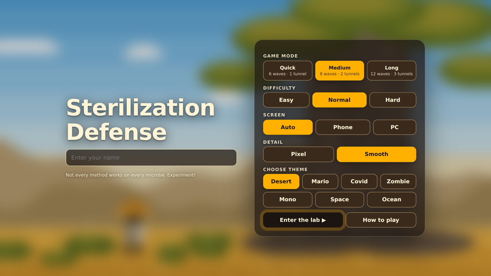
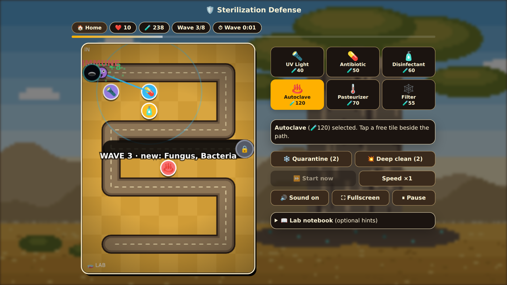
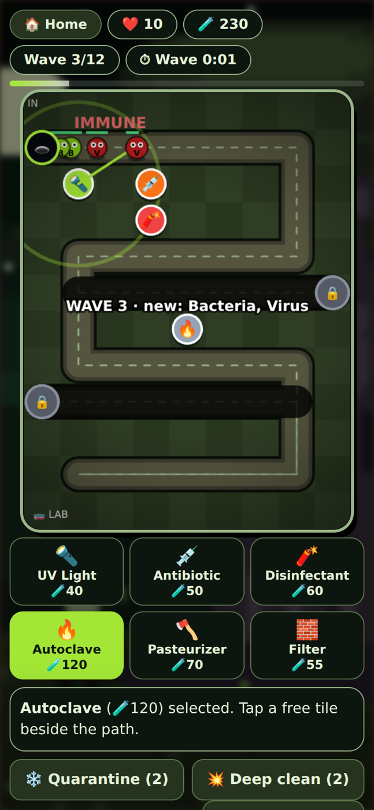
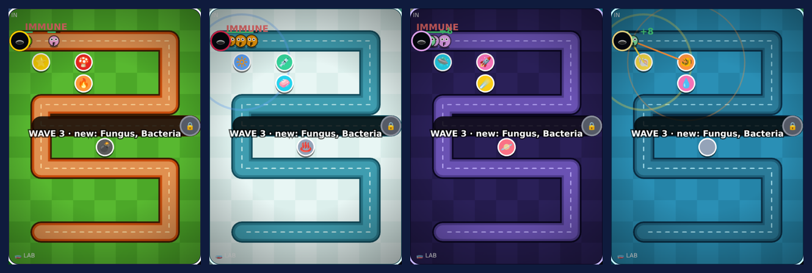

<div align="center">

# 🛡️ Sterilization Defense

**A tower-defense game about microbial control. Pick the right sterilization method for every microbe and keep the lab safe.**

[](https://avi-199lh.github.io/Sterilization_Defense/)




</div>

---

## 📖 About

Microbes march through tunnels towards your lab. Every defense works on some microbes and fails on others, so you learn real microbiology by playing: why antibiotics don't touch viruses, why endospores survive almost everything except an autoclave, and why filters don't stop viruses.

It is a single `index.html` file with no libraries, no build step and no login. It runs in any modern browser on phones and computers.

## ✨ Features

- **3 game modes** with up to **3 tunnels** that open as waves progress
- **Automatic waves** with a prep timer and a live wave timer
- **6 defenses**, each with real strengths and weaknesses
- **8 microbe types**, including a prion boss
- **7 themes**: Desert, Mario, Covid, Zombie, Mono, Space, Ocean (scene, board, icons and colors all change)
- Phone and PC layouts, plus Pixel and Smooth graphics
- Sound effects, music, particles, screen shake and a first-time tutorial
- Upgrades, kill combos, perfect-wave bonuses and a local best score
- Remembers your settings between visits

## 🖼️ Screenshots

| PC gameplay | Phone gameplay |
|---|---|
|  |  |



## 🎮 How to play

1. Enter your name, then choose a **mode**, **difficulty**, **screen** and **theme**.
2. Tap a defense, then tap a free tile beside the path to build it.
3. Waves start by themselves when the prep timer ends (press **Start now** to skip the wait).
4. Tap a tower to upgrade it (selling is disabled). You can place at most **2 of each defense per tunnel line**.
5. Tap microbes to swab them for 10 damage. Kill 3 or more quickly for combo gold.
6. **Quarantine** and **Deep clean** are emergency buttons: 2 uses each, only during a wave.
7. Don't let microbes reach the lab. Survive every wave to win.

**PC keys:** `1`-`6` choose a defense · `Space` start next wave · `P` pause · `M` mute

## 🕹️ Game modes

| Mode | Waves | Tunnels | Style |
|---|---|---|---|
| Quick | 6 | 1 | Steady and predictable |
| Medium | 8 | 2 (second opens at wave 4) | Unpredictable arrivals and sudden rushes |
| Long | 12 | 3 (open at waves 1, 5 and 9) | Unpredictable, tougher microbes, boss wave |

| Difficulty | Lives | Starting gold |
|---|---|---|
| Easy | 15 | 170 |
| Normal | 10 | 130 |
| Hard | 7 | 110 |

## 🧪 Defenses

| Defense | Cost | Works on | Weak against |
|---|---|---|---|
| UV Light | 40 | Bacteria, fungi | Endospores |
| Antibiotic | 50 | Bacteria | Viruses, fungi, spores, resistant strains |
| Disinfectant (splash) | 60 | Bacteria, viruses, fungi | Endospores |
| Autoclave (slow, strong) | 120 | Everything, including spores | Prions (partly) |
| Pasteurizer | 70 | Bacteria, viruses, fungi | Spores |
| Filter (slows enemies) | 55 | Traps bacteria, spores, fungi, cysts | Viruses pass through |

## 🦠 Microbes

Bacteria · Virus · Fungus · Endospore · MRSA (antibiotic-resistant) · Protozoan cyst · Biofilm · Prion (boss)

New microbes arrive without hints. A short lab report after each wave explains what you just faced.

## 🚀 Run it locally

No install needed. Download or clone the repository and open `index.html` in a browser.

```bash
git clone https://github.com/Avi-199LH/Sterilization_Defense.git
cd Sterilization_Defense
# then double-click index.html, or serve it:
python3 -m http.server 8000   # open http://localhost:8000
```

## 🌐 Deploy on GitHub Pages

1. Push this repository to GitHub (public).
2. Open **Settings → Pages**.
3. Under **Build and deployment**, choose **Deploy from a branch**, branch **main**, folder **/ (root)**, then **Save**.
4. After a minute or two your game is live at `https://avi-199lh.github.io/Sterilization_Defense/`.

## 📁 Project structure

```
Sterilization_Defense/
├── index.html          # the whole game (HTML + CSS + JavaScript)
├── README.md
├── LICENSE
├── CHANGELOG.md
├── CONTRIBUTING.md
├── .gitignore
├── .github/
│   └── ISSUE_TEMPLATE/ # bug and idea templates
└── *.png               # screenshots used in this README
```

## 🛠️ Built with

Plain HTML5, CSS and JavaScript. The playfield is drawn on a `<canvas>`, sounds use the Web Audio API, and settings are saved with `localStorage`. The Inter font is loaded from Google Fonts and falls back to the system font when offline.

## 🎓 What it teaches

- Autoclaving (121 °C, 15 psi) is the dependable way to kill endospores
- Antibiotics act on bacteria only
- UV and disinfectants suit surfaces; pasteurization is not sterilization
- Filtration removes cells but viruses pass through
- Resistance genes (for example in MRSA) make antibiotics fail
- Biofilms and prions resist ordinary control methods

## 🗺️ Roadmap

- [ ] More levels and maps
- [ ] Online leaderboard
- [ ] Food and industrial microbiology levels
- [ ] Quiz after each wave
- [ ] Translations

## 🤝 Contributing

Ideas and fixes are welcome. Please read [CONTRIBUTING.md](CONTRIBUTING.md) first.

## 📄 License

Released under the [MIT License](LICENSE).

## 👤 Author

**Avinash Pandey** · [@Avi-199LH](https://github.com/Avi-199LH)

If you enjoyed the game, please give the repository a ⭐
